<div align="center">

<picture>
  <source media="(prefers-color-scheme: dark)" srcset="docs/images/banner-dark.svg">
  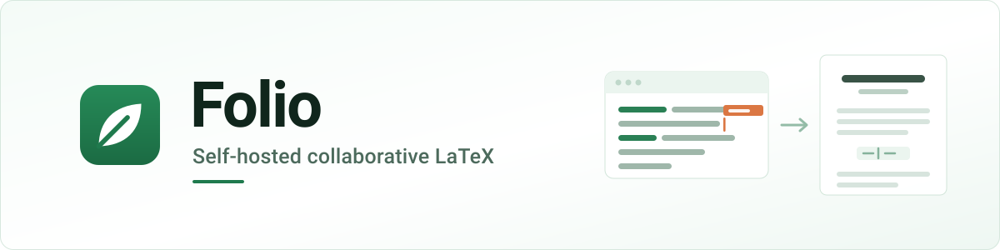
</picture>

### Write LaTeX together, in your browser, on your own server.

<p>


</p>

[Why Folio](#why) ·
[Features](#features) ·
[Quick start](#quick-start) ·
[Screenshots](#screenshots) ·
[Configuration](#configuration) ·
[Accounts](#accounts) ·
[Backups](#backups) ·
[Security](#security) ·
[Troubleshooting](#troubleshooting) ·
[Development](#development)

<br>

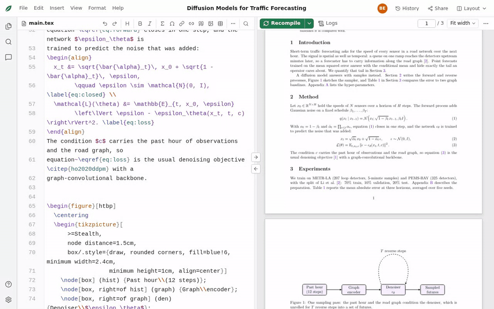

<sub>Type, let a collaborator type alongside you, recompile, and double-click the PDF to land on the line that made it.</sub>

</div>

<br>

<a id="why"></a>

## 💡 Why Folio

<table>
<tr>
<td width="33%" valign="top">

### 🔒 It is yours
Your drafts, figures and history sit on **your disk**, under `data/`. No seats to buy, no
per-collaborator cost, and no third party holding an unpublished manuscript.

</td>
<td width="33%" valign="top">

### 🧰 The real toolchain
A **full TeX Live 2026** in a locked-down container: every package, four engines, BibTeX and
Biber, and your own compile timeouts. If it compiles on your laptop, it compiles here.

</td>
<td width="33%" valign="top">

### 🧪 Built to be trusted
**565 unit and 78 browser tests**, two adversarial review rounds (109 findings, fixed and
independently re-verified), and a 41-page paper with TikZ figures and mutual `xr`
cross-references as the acceptance test.

</td>
</tr>
</table>

Folio suits a research group, a lab or a department that wants this way of working on one machine
it controls.

> [!NOTE]
> Folio is an independent implementation. It contains no Overleaf source code; see
> [NOTICE.md](NOTICE.md).

<br>

<a id="features"></a>

## ✨ What it is like to use

<table>
<tr>
<td width="55%" valign="top">
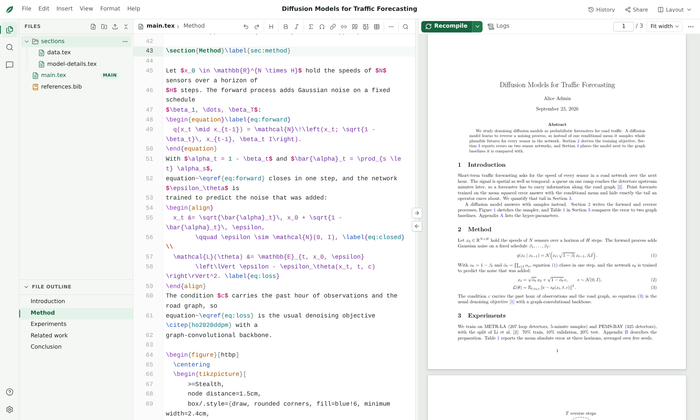
</td>
<td valign="top">

### ✍️ An editor that knows LaTeX
CodeMirror 6 with completion for commands, environments, `\ref` labels, `\cite` keys (from `.bib`
files **and** `\bibitem`) and file paths. Environments close themselves, sections fold, the
outline follows your cursor, and equations preview as you type. Vim and Emacs keys included.

</td>
</tr>
<tr>
<td valign="top">

### 👥 Everyone in the same document
Named, coloured cursors, presence in the file tree, and undo that only undoes **your** edits.
Work offline and your text is kept, announced and sent when the connection returns. A server
restart loses nothing, and no edit is ever dropped silently.

</td>
<td width="55%" valign="top">
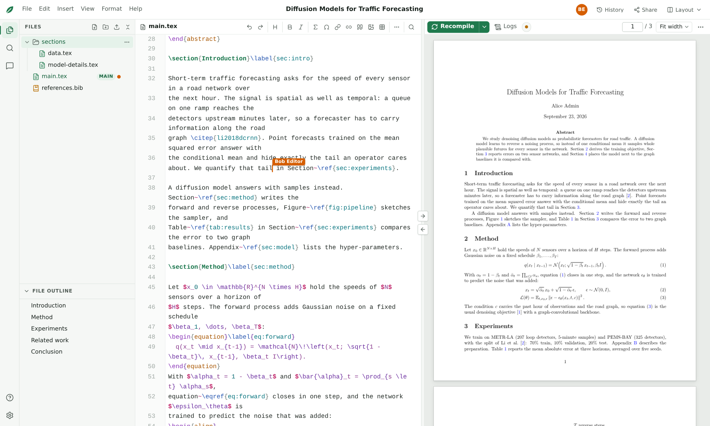
</td>
</tr>
<tr>
<td width="55%" valign="top">
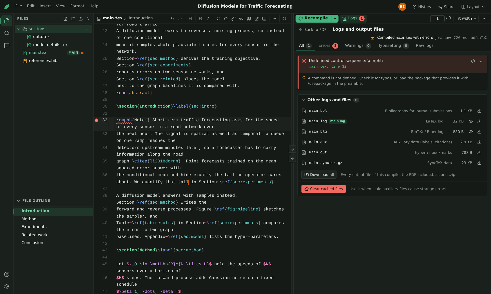
</td>
<td valign="top">

### ⚡ Compile, then find the problem
pdfLaTeX, LaTeX, XeLaTeX or LuaLaTeX through **latexmk**, auto-compiling while you type, with
draft mode and stop-on-first-error. A paper and its `xr` supplement each keep their own PDF. The
log becomes errors, warnings and bad boxes, each with a hint and a link to the line.

</td>
</tr>
<tr>
<td valign="top">

### 🕰️ Every version, in git
Versions are saved as you work. Compare any two, see who changed what, restore a single file or
the whole project, label a submission, and download any version as a `.zip`. Delete a file by
mistake and its last text is still there.

</td>
<td width="55%" valign="top">
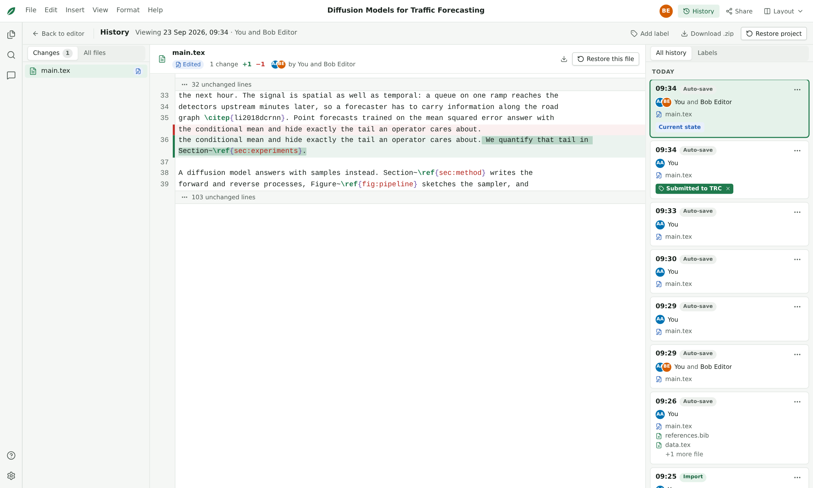
</td>
</tr>
<tr>
<td width="55%" valign="top">
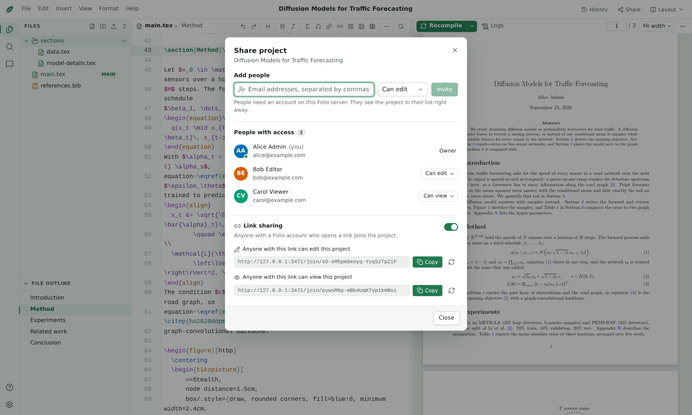
</td>
<td valign="top">

### 🔗 Share on your terms
Owners, editors and viewers, enforced on the server rather than hidden in the UI. Invite people
by email address or hand out an **edit** or **view-only** link. Each project has a chat, and a
viewer can still compile and read the PDF.

</td>
</tr>
</table>

<br>

<a id="compare"></a>

## ⚖️ Self-hosting, honestly

Folio is not a drop-in replacement for a hosted service, and the trade is a real one.

**What self-hosting gives you**

| | |
|---|---|
| **Your data** | Everything lives under `DATA_DIR` on your machine; back it up with one command |
| **No seats** | Every colleague you can create an account for, at no cost per person |
| **The whole of TeX Live** | Full scheme, four engines, BibTeX and Biber, your own compile timeouts (30–600 s) |
| **A real history** | A git repository per project that you can read, archive or copy yourself |
| **SyncTeX both ways** | Source ↔ PDF, matched against the reference `synctex` tool |
| **It works without the internet** | A LAN, an air-gapped lab or a laptop on a train is fine |

**What Folio does not have**

| | |
|---|---|
| **A visual (rich-text) editor** | Source mode only |
| **Track changes and comments** | Not implemented ([roadmap](#roadmap)) |
| **A templates gallery** | Start blank, from the example project, or from a `.zip` |
| **Mobile apps** | The web app is built for a desktop browser |
| **Someone else's operations** | You run the machine, the backups and the updates |

<br>

<a id="quick-start"></a>

## 🚀 Quick start

### Folio in 60 seconds

```bash
npm install && npm run build      # once
npm start                         # → http://127.0.0.1:3100
```

Open the URL and the **setup page** creates your administrator account. That is the whole
installation; everything below is detail.

### What you need

| Requirement | Why |
|---|---|
| **Node.js 22.12+** | runs the server and the build |
| **Docker**, usable without `sudo` (`docker info` works) | the compile sandbox |
| **git 2.24+** | each project's history |
| **~6 GB of disk** | the TeX Live image (`docker pull texlive/texlive:latest-full`, about 5 GB) |
| *optional:* the `sqlite3` CLI | only for the backup and integrity steps you may run **by hand**; `npm run backup` and the server use SQLite directly |

Folio is tested on Linux (Ubuntu) and works on macOS with Docker Desktop.

### The longer version

```bash
npm install                                 # install everything; do not use --omit=dev
docker pull texlive/texlive:latest-full     # once, about 5 GB
npm run build                               # builds the web app into web/dist
npm run doctor                              # checks Docker, the image, git and the data directory
npm start                                   # → http://127.0.0.1:3100
```

You can create the administrator from the command line instead of the setup page:

```bash
npm run create-user -- --email you@example.com --name "Your Name" --password "a long password" --admin
```

> [!TIP]
> `npm run setup -- --pull` does the first block for you: it checks the machine, pulls the TeX
> Live image, builds the web app and prints what to do next.

### Import an existing paper

From the dashboard, choose **New project → Upload a .zip**. An administrator can also import a
directory directly:

```bash
npm run seed -- --src ~/papers/my-paper --owner you@example.com --name "My Paper" \
  --main paper.tex --compiler xelatex --external supplementary.tex
```

Symlinks, build output (`.aux`, `.log`, `.synctex.gz`, the PDF next to the main `.tex`…), hidden
files, `ready/` and `*.zip` are skipped. `--external` lists `xr` documents to build before the main
one; without it, Folio finds `\externaldocument` by itself. Folio edits its **own copy** in the
data directory; the source directory is never touched.

Folio stores text as UTF-8. Text files saved in another encoding (a Windows code page, Latin-1, or
UTF-16 from Notepad) are converted when you import or upload them, so they stay editable. Folio
reads the encoding from `\usepackage[…]{inputenc}` or `% !TEX encoding`, in the file or in the
main document. Without one, it uses Windows Western, or Windows Cyrillic for Cyrillic text. Legacy
`inputenc` declarations are then changed to `utf8`. HTML, XML, Python and CSS files name their own
encoding and are never converted. A file that is already read-only becomes editable when you
upload it again with **Replace…**.

### Everyday commands

| Command | What it does |
|---|---|
| `npm start` | Run Folio (serves the built web app) at <http://127.0.0.1:3100> |
| `npm run dev` | Development mode with hot reload: open <http://127.0.0.1:5173> |
| `npm run backup` | Write a backup of everything Folio stores ([Backups](#backups)) |
| `npm run doctor` | Check the installation (`-- --compile` also compiles a test document) |
| `npm run create-user -- …` | Add an account (`--admin` for an administrator) |
| `npm run reset-password -- --email … --password …` | Set a new password and sign that person out everywhere |
| `npm run seed -- --src … --owner …` | Import a directory as a project |

The command-line tools work on the data directory directly and can run while the server is running.

<br>

<a id="screenshots"></a>

## 📸 A closer look

<table>
<tr>
<td width="33%" valign="top">
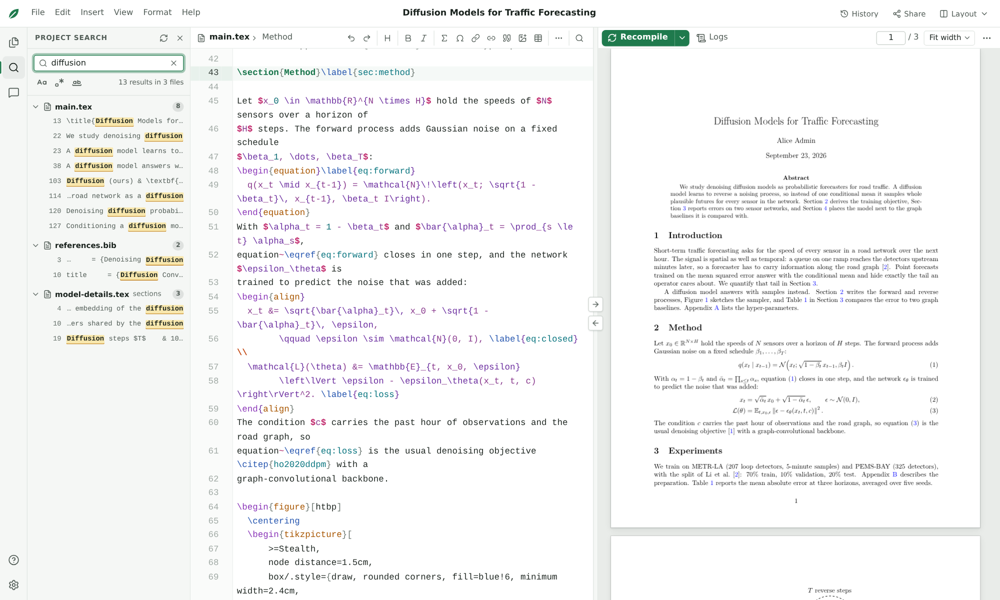
<p align="center"><b>Search the whole project</b><br><sub>Regex, case and whole word, grouped by file</sub></p>
</td>
<td width="33%" valign="top">
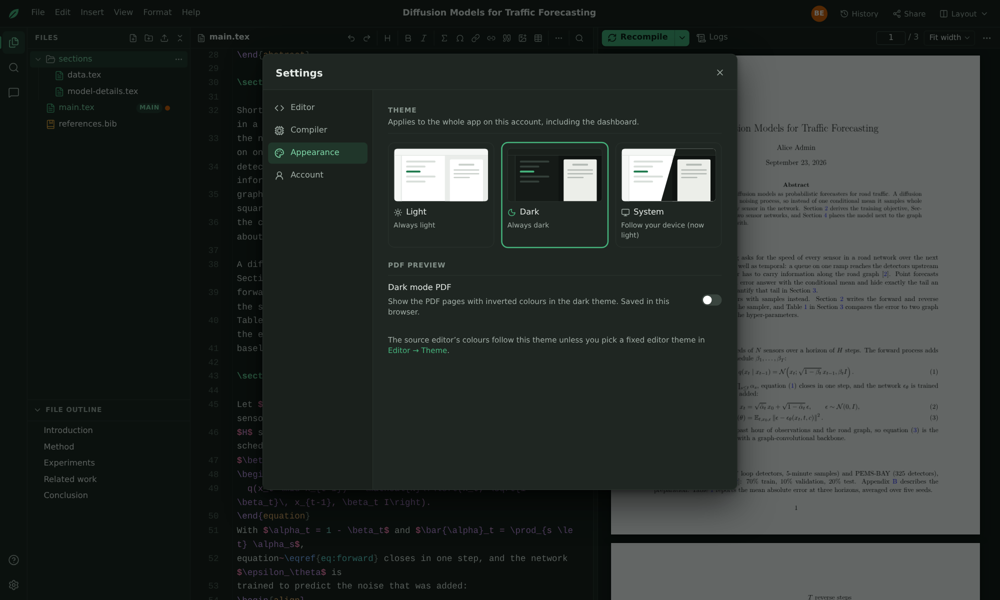
<p align="center"><b>Make it yours</b><br><sub>Themes, fonts, keybindings, compiler</sub></p>
</td>
<td width="33%" valign="top">
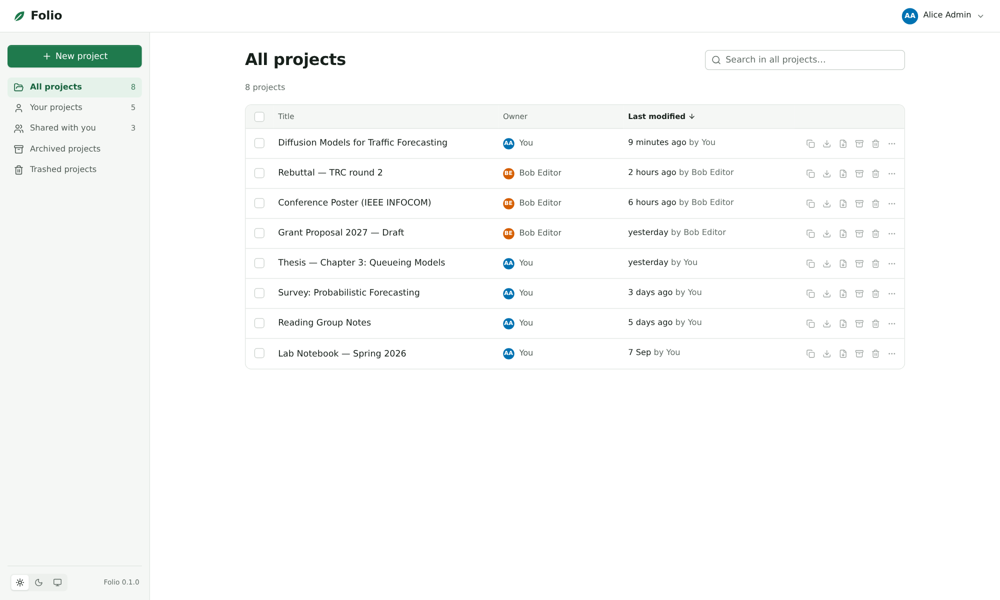
<p align="center"><b>All your projects</b><br><sub>Yours and shared, archive and trash</sub></p>
</td>
</tr>
</table>

<details>
<summary><b>⌨️ Keyboard shortcuts</b> (<kbd>Mod</kbd> = <kbd>Ctrl</kbd>, or <kbd>⌘</kbd> on macOS)</summary>
<br>

| Action | Keys |
|---|---|
| Recompile | <kbd>Mod</kbd>+<kbd>Enter</kbd> or <kbd>Mod</kbd>+<kbd>S</kbd> |
| Find / find and replace | <kbd>Mod</kbd>+<kbd>F</kbd> / <kbd>Mod</kbd>+<kbd>H</kbd> |
| Search in all project files | <kbd>Mod</kbd>+<kbd>Shift</kbd>+<kbd>F</kbd> |
| Go to line | <kbd>Mod</kbd>+<kbd>Shift</kbd>+<kbd>L</kbd> |
| Next compile problem | <kbd>F8</kbd> |
| Bold / italic | <kbd>Mod</kbd>+<kbd>B</kbd> / <kbd>Mod</kbd>+<kbd>I</kbd> |
| Toggle comment | <kbd>Mod</kbd>+<kbd>/</kbd> |
| Show suggestions | <kbd>Ctrl</kbd>+<kbd>Space</kbd> |
| Fold / unfold at the cursor | <kbd>F2</kbd> |
| Focus mode | <kbd>Mod</kbd>+<kbd>Shift</kbd>+<kbd>M</kbd> |
| Go from the PDF to the code | double-click in the PDF |
| PDF zoom / fit width / fit page | <kbd>Mod</kbd>+<kbd>=</kbd> <kbd>Mod</kbd>+<kbd>-</kbd> / <kbd>Mod</kbd>+<kbd>0</kbd> / <kbd>Mod</kbd>+<kbd>9</kbd> |

The complete list is under **Help → Keyboard shortcuts** in the app.

</details>

<br>

<a id="configuration"></a>

## ⚙️ Configuration

Folio reads environment variables. It also reads a `.env` file next to `package.json` (copy
[`.env.example`](.env.example)), or the file named by `FOLIO_ENV_FILE` (`none` reads no file).
Variables already set in the environment take precedence.

| Variable | Default | Meaning |
|---|---|---|
| `PORT` / `HOST` | `3100` / `127.0.0.1` | Where the server listens. Use `0.0.0.0` only behind a firewall or reverse proxy. |
| `PUBLIC_ORIGIN` | – | The URL people use, e.g. `https://latex.example.com` (scheme + host, no path). **Set it whenever Folio is reachable under a domain name.** It anchors the CSRF/WebSocket origin check and makes the session cookie `Secure` on https. Folio refuses to start with a malformed value; `npm run doctor` says what is wrong. |
| `DATA_DIR` | `./data` | Everything Folio stores ([see below](#backups)). |
| `COMPILE_RUNNER` | `docker` | `docker` (sandboxed), `local` (latexmk on the host: **not sandboxed**, only for single-user machines), `fake` (tests). |
| `COMPILE_IMAGE` | `texlive/texlive:latest-full` | TeX Live image. Folio never pulls it by itself. |
| `MAX_CONCURRENT_COMPILES` | `4` | Compiles running at once. Up to twice as many wait; beyond that users see "busy, try again". |
| `COMPILE_TIMEOUT_SEC` | `240` | Default timeout of new projects (each project can set 30–600 s). |
| `COMPILE_MEMORY` / `COMPILE_CPUS` | `2g` / `2` | Limits of every compile container. |
| `COMPILE_USER` | your `uid:gid` | User inside the containers; it must be able to write the data directory. |
| `ALLOW_SIGNUP` | `false` | Let anyone create an account at `/register` (otherwise the admin creates accounts). |
| `SESSION_TTL_DAYS` | `30` | Sessions expire after this many days *without use* (they are extended while used). |
| `MAX_UPLOAD_MB` | `50` | Largest single uploaded file (a zip import may expand to 300 MB). |
| `LOG_LEVEL` | `info` | `debug`, `info`, `warn` or `error`. Development logs are pretty-printed; `npm start` writes JSON lines (`npm start --silent`, or `node --import tsx server/src/main.ts`, leaves out npm's own header lines). |
| `WEB_DIST` | `web/dist` | The built web app served by `npm start`. |

> [!NOTE]
> Under `npm run dev`, the Vite dev server reads the same environment and `.env` as the server.
> `PORT` and `HOST` move the API and the UI's proxy to it together, and `VITE_PORT` (default
> `5173`) moves the UI. `FOLIO_API=http://host:port` points the UI at another server instead.

<br>

<a id="accounts"></a>

## 👤 Accounts

Folio sends no email, so there are no invitations and no "forgot password" link. An
administrator creates accounts and resets passwords, in the browser or on the server.

| Way | Who | Notes |
|---|---|---|
| The **setup page** | Whoever opens Folio first | Shown only while there are no accounts. This first account is always an administrator. |
| **Admin → New user** | An administrator | Enter a name, an email and a starting password; tick **Administrator** if needed. Copy the sign-in details and send them yourself: the password is not shown again. |
| `npm run create-user -- …` | Anyone with a shell on the server | Add `--admin` for an administrator. |
| **Create an account** on the login page | Anyone who can reach the server | Only with `ALLOW_SIGNUP=true`. These accounts are never administrators. |

The **Admin** page (the account menu at the top right → **Admin**) lists every account, and creates
and deletes them. Deleting an account also deletes the projects it owns, with their files, history
and chat, for every collaborator. The Admin page cannot reset passwords or change who is an
administrator.

### Passwords

Anyone who is logged in can change their own password under **Account settings → Password**, by
entering the current one. A forgotten password, an administrator's included, can only be reset on
the server:

```bash
npm run reset-password -- --email you@example.com --password "a new password"
```

This also signs the account out everywhere. Passwords need at least 8 characters.

> [!IMPORTANT]
> Anyone who can run commands on the server, or read its `data/` directory, can create or reset
> any account. Give that access only to the people who run Folio.

<br>

<a id="backups"></a>

## 💾 Data and backups

Everything lives under `DATA_DIR`:

| Path | Contents | Back up? |
|---|---|:---:|
| `db.sqlite` (+ `db.sqlite-wal`, `db.sqlite-shm`) | accounts, sessions, projects, members, file index, labels, chat | ✅ |
| `projects/<id>/` | each project's files as plain files (what you would download as `.zip`) | ✅ |
| `history/<id>.git` | each project's history (a bare git repository whose work tree is `projects/<id>`) | ✅ |
| `ystate/<id>/` | the collaborative editing state of each text file | ✅ |
| `builds/<id>/` | recent compile outputs (PDF, log, SyncTeX) | optional |
| `compiles/<id>/` | compile working directories (removed after 3 idle days) | – |
| `texcache/` | TeX font caches (rebuilt on the first compile, about a minute) | – |
| `previews/`, `tmp/` | EPS previews, uploads in progress | – |

**Housekeeping is automatic.** After every compile and every hour, each project keeps its newest
5 builds, **builds from the last 30 minutes up to 20 in all**, the last and last successful build
of each root document, and builds someone opened in the last 10 minutes. Once a project has been
idle for 3 days, only its newest build and each root document's last builds stay. Each build is a
full copy of the PDF, SyncTeX file and logs; only an unchanged `xr` external document's PDF and
log are shared with the previous build. A project that auto-compiles while people type can use a
few hundred MB for a while. Folio also removes compile directories unused for 3 days, the
leftovers of deleted projects, expired sessions and stale temporary files, and packs each
project's history (`git gc`) every 200 versions, or daily when it needs it.

### Backing up

**`npm run backup` does it in one command, running or stopped, with no other tools.** It copies
the database with SQLite's own online backup (a consistent snapshot, checked before it is
written, no stale `-wal` to worry about) and streams `projects/`, `history/` and `ystate/` into a
dated archive:

```bash
npm run backup                                     # → ./folio-backup-2026-09-21-0300.tgz
npm run backup -- --out /backups                   # → a backup directory there instead
npm run backup -- --out /backups/nightly.tgz --quiet   # for cron: prints only the path
```

| Option | What it does |
|---|---|
| `--out <path>` | `.tgz` / `.tar.gz` → that archive; any other path → a backup **directory** there |
| `--data <dir>` | back up another data directory (default: `DATA_DIR`, else `./data`) |
| `--force` | overwrite the archive, or write into a directory that is not empty |
| `--quiet` | print only the path of the backup |

It prints what it wrote — files, size, projects, accounts — and the steps to restore it. What it
writes **is** a data directory, so restoring is the same as below (without the rename step).

<details>
<summary><b>Backing up by hand</b> (needs <code>tar</code>, and <code>sqlite3</code> while Folio runs)</summary>
<br>

**With Folio stopped** (the most consistent). Include the database's `-wal` and `-shm` files, in
case Folio did not stop cleanly:

```bash
sudo systemctl stop folio          # or Ctrl+C in the terminal running `npm start`
cd /path/to/data && tar czf ~/folio-$(date +%F).tgz db.sqlite* projects history ystate
sudo systemctl start folio
```

**While Folio runs.** Copy the database with SQLite's online backup, then the directories:

```bash
sqlite3 data/db.sqlite ".backup data/db.backup.sqlite"
tar czf ~/folio-$(date +%F).tgz -C data db.backup.sqlite projects history ystate
```

</details>

Open documents are saved to disk within 10 seconds of the last keystroke.

### Restoring

> [!WARNING]
> Never extract a backup over an existing data directory, and never copy only `db.sqlite` back
> while an old `db.sqlite-wal` is still next to it. SQLite would replay the stale journal onto the
> restored file and silently corrupt it.

1. **Stop Folio and make sure it is gone:** nothing listens on its port (`ss -ltnp | grep :3100`).
2. **Move the current data aside:** `mv data data.before-restore-$(date +%F)`.
3. **Extract into an empty directory:** `mkdir data && tar xzf ~/folio-2026-09-21.tgz -C data`.
   (A `npm run backup -- --out` directory is copied instead: `cp -a /backups/2026-09-21 data`.)
4. **For an online backup, rename the database:** `mv data/db.backup.sqlite data/db.sqlite`.
   A `npm run backup` archive already holds `db.sqlite`: skip this step.
5. **Check it before starting:** `sqlite3 data/db.sqlite "PRAGMA integrity_check"` should print `ok`.
   (`npm run backup` checked its copy when it wrote it.)
6. **Start Folio.** The font cache and builds are recreated as needed.

To move a single project elsewhere, download it as a `.zip`, or download any version from the
History view.

<br>

<a id="security"></a>

## 🛡️ Security

Folio is built for **one team that trusts each other**, such as a research group on a shared
server. It is not a hardened multi-tenant service.

<details open>
<summary><b>What protects you</b></summary>
<br>

- **The compile sandbox.** Every compile runs in a new Docker container with no network
  (`--network none`), a read-only root file system, all capabilities dropped, `no-new-privileges`,
  and limits on processes, memory, CPU and wall-clock time. It runs as the user that runs Folio,
  so **do not run Folio as root** (with the Docker runner it refuses to start as root unless
  `COMPILE_USER` names an unprivileged user). latexmk runs with `-norc`, shell escape is off
  (only TeX Live's restricted `\write18` list), and the container sees only the project's
  compile directory and the font cache.
- **Defensive file handling.** Uploads and zip imports reject path traversal and symlinks and
  check sizes and compression ratios. Everything under the data directory is written with
  symlink-safe atomic writes.
- **Serving uploaded files.** Files are sent with `X-Content-Type-Options: nosniff`. Only PDFs and
  raster images are shown inline; SVG, HTML and scripts are downloads with a sandbox CSP.
- **Accounts and requests.** Passwords are hashed with scrypt, and only a hash of each session
  token is stored. Cookies are `HttpOnly` and `SameSite=Lax`. Every state-changing request needs a
  custom header and a same-origin `Origin`. Logins are rate-limited (20 per 15 minutes per IP).
  Logging out, changing the password or deleting an account closes that person's live editor
  connections; logging out also asks the browser to drop its cached PDFs and logs. A logout made
  while offline signs the browser out at once and reaches the server as soon as it can. Each
  account may hold at most 200 open editor connections.
- **Roles.** Roles are enforced on the server for every REST route and on the WebSocket. A
  viewer's edits are never applied: the server closes the socket, and the browser keeps the text
  aside for the person to copy.

</details>

<details>
<summary><b>What you trust your users with</b></summary>
<br>

- **Disk use.** There are no per-user quotas. An editor can fill the disk within the upload and
  compile limits (see the build retention above).
- **The shared font cache.** All projects share `texcache/`, which one project could tamper with.
- **The local runner.** `COMPILE_RUNNER=local` runs TeX on the host with your permissions. Use it
  only when you are the only user.

</details>

### Exposing Folio beyond localhost

- Put it behind an **HTTPS reverse proxy** and set `PUBLIC_ORIGIN`.
- Serve it at the **root** of its origin. Sub-paths such as `https://example.com/folio` are not
  supported.
- The proxy must pass WebSocket upgrades on `/ws/` and the original `Host` (including its port)
  and `X-Forwarded-Proto`, or `X-Forwarded-Host` with the port. Folio trusts `X-Forwarded-*` only
  from a loopback proxy. Behind a proxy on another host (or in a container), every client seems
  to come from the proxy's address and they share one login rate limit (20 per 15 minutes).
- Folio compresses its responses itself (brotli or gzip), so `gzip` in the proxy is optional.
- Finish `/setup` right after the first start. Until then, anyone who can reach the server could
  create the administrator.

```nginx
location / {
  proxy_pass http://127.0.0.1:3100;
  proxy_http_version 1.1;
  proxy_set_header Host $http_host;                  # keeps the port, unlike $host
  proxy_set_header X-Forwarded-Proto $scheme;
  proxy_set_header X-Forwarded-For $proxy_add_x_forwarded_for;
  proxy_set_header Upgrade $http_upgrade;
  proxy_set_header Connection $connection_upgrade;   # map $http_upgrade → "upgrade" / "close"
  client_max_body_size 350m;
  proxy_read_timeout 3600s;
}
```

### Running as a service

Run the server with `node` directly, so the service manager's stop signal reaches it once and it
can save everything before exiting:

```ini
# /etc/systemd/system/folio.service
[Unit]
Description=Folio collaborative LaTeX editor
After=network.target docker.service
Requires=docker.service

[Service]
# a normal user in the docker group, never root
User=folio
WorkingDirectory=/opt/folio
Environment=NODE_ENV=production
ExecStart=/usr/bin/node --import tsx server/src/main.ts
TimeoutStopSec=40
Restart=on-failure

[Install]
WantedBy=multi-user.target
```

**Updating Folio:** take a backup (`npm run backup`), update the code, then run `npm install`,
`npm run build` and restart the service.

<br>

<a id="troubleshooting"></a>

## 🩺 Troubleshooting

`npm run doctor` checks everything below and prints the fix for each problem.

<details>
<summary><b>Compiling</b></summary>
<br>

| Symptom | Fix |
|---|---|
| "Docker is not running or not reachable" | Start Docker (`sudo systemctl start docker`). If you use `DOCKER_HOST` or a Docker context, it must be set for the Folio process. |
| "permission denied … docker.sock" | `sudo usermod -aG docker $USER`, then log in again and restart Folio. |
| "The TeX Live image … is not installed" | `docker pull texlive/texlive:latest-full` |
| The first compile takes about a minute | The one-time font cache warm-up. Later compiles of a normal paper take 1–8 s. |
| A compile "timed out" | Raise the timeout in the project settings (up to 600 s), or look for an endless loop in the log. |
| Citations or references show `??` | Recompile once. With `xr`, the external document is built automatically; you can pin it under **Settings → Compiler**. |
| "The compile server is busy" | More than `MAX_CONCURRENT_COMPILES` compiles are running. Try again, or raise the limit. |

</details>

<details>
<summary><b>Starting the server</b></summary>
<br>

| Symptom | Fix |
|---|---|
| "The web app has not been built" | `npm run build`, or use `npm run dev`. |
| "Port 3100 … is already in use" | Another Folio (or another program) is running there. Stop it, or set `PORT` in the environment or `.env`. Under `npm run dev` the UI follows it; if port 5173 is taken too, set `VITE_PORT` (see [Configuration](#configuration)). |
| `tsx: not found` or `vite: not found` | Dependencies are missing: run `npm install`. Building the web app needs the dev packages too, so do not install with `--omit=dev` or `NODE_ENV=production`. |
| `npm run doctor` says the database failed its `quick_check` | The file is damaged and cannot be repaired in place. Stop Folio and restore your newest backup ([Backups](#backups)). |

</details>

<details>
<summary><b>Accounts and connections</b></summary>
<br>

| Symptom | Fix |
|---|---|
| Forgot the admin password | `npm run reset-password -- --email you@example.com --password "…"` ([Accounts](#accounts)) |
| The editor keeps showing "Reconnecting…" behind a proxy | The proxy must forward WebSocket upgrades on `/ws/`. Check that `PUBLIC_ORIGIN` exactly matches the URL in the browser. |
| "Cross-origin request rejected" behind a proxy | Set `PUBLIC_ORIGIN`, or forward the original `Host` with its port (`$http_host` in nginx) and `X-Forwarded-Proto`. |

</details>

The server log says which module failed (`compile`, `collab`, `history`, …). Refused requests
are logged too: `login failed`, `request rejected: cross-origin` (a proxy or `PUBLIC_ORIGIN`
problem) and `rate limit reached`. Run with `LOG_LEVEL=debug` for more detail.

<br>

<a id="development"></a>

## 🧑‍💻 Development

```bash
npm run dev            # server (tsx watch, port 3100) + Vite with hot reload (http://127.0.0.1:5173)
npm test               # unit and integration tests (Vitest)
npm run test:docker    # the same, plus the suites that compile real documents in Docker
npm run e2e            # Playwright end-to-end tests against a throw-away server (about 3 minutes)
npm run e2e:fake       # the same without Docker (specs that need real TeX skip themselves)
npm run test:scripts   # checks npm run backup and the README restore steps, npm start signals, the scripts' env handling
npm run typecheck      # shared, server, web and e2e
```

**An isolated instance with sample data.** This starts a complete Folio with its own data
directory and ports. It has the users alice (admin), bob (editor) and carol (viewer), all
`@example.com` with the password `folio-pass-123`, plus the paper from `../` and an Example project.
Like the e2e server, it never reads your `.env`:

```bash
node scripts/dev-instance.mjs --name me --dir /tmp/folio-me --port 3310 --vite-port 5310 [--fresh] [--no-paper]
node scripts/dev-instance.mjs --stop --dir /tmp/folio-me
```

<details>
<summary><b>End-to-end test suite</b></summary>
<br>

`npm run e2e` builds `web/dist` when its sources changed and starts `scripts/e2e-server.mjs` with a
fresh temporary data directory, the same users and the same projects as a dev instance. Settings:
`COMPILE_RUNNER=fake` skips Docker, `E2E_PORT` sets the port (default 3199), `E2E_PAPER=0` leaves
out the paper. The specs live in `e2e/`, one per area:

| Spec | Covers |
|---|---|
| `editor` | typing; `\ref` / `\cite` / `\includegraphics` / `\begin` completion; environment auto-close; formatting keys; folding; find & replace; go to line; outline; diagnostics after a failing compile |
| `collab`, `collab-editor` | two editors (live text, presence, named carets, per-user undo); viewers read-only; live role changes; a file deleted while being typed in; offline edits kept, announced and sent; offline edits to a deleted, re-created or replaced file kept aside; an editor made a viewer while offline |
| `compile`, `pdf`, `paper` | compiling; the PDF pane (zoom and scroll kept, logs, stop on first error, draft, stop, clear cache, auto compile, word count, download); a viewer compiling; the real paper (0 errors, 0 undefined references, the `xr` supplement); SyncTeX both ways |
| `roots` | two root documents: each collaborator keeps the PDF of their own document, download names (toolbar and dashboard), after a reload |
| `positions`, `unicode-paths` | cursor and scroll position of each file after switching files and reloading; a Unicode path through the tree, breadcrumb, search, history and logs |
| `filetree`, `upload` | create / rename / move / delete, uploads and drops with conflicts, main document, PNG / PDF / EPS previews, zip import |
| `history` | versions with summaries, diff, compare, labels, download, restoring a file and the project |
| `share`, `share-join`, `chat`, `search`, `settings`, `admin`, `dashboard`, `auth`, `setup`, `restart` | the rest of the app, including a logout while offline and a server restart with open editors |
| `env-isolation` | test servers ignore the developer's `.env` and `PUBLIC_ORIGIN` |

`e2e/helpers.ts` has helpers for logging in, throw-away projects, the editor, Yjs doc sessions,
compiling, cutting the WebSockets (offline editing) and extra isolated servers. Import `test` from
it: its browser contexts start with auto compile off, so only the tests that ask for a compile run
TeX.

</details>

<br>

<a id="how-it-works"></a>

## 🏗️ How it works

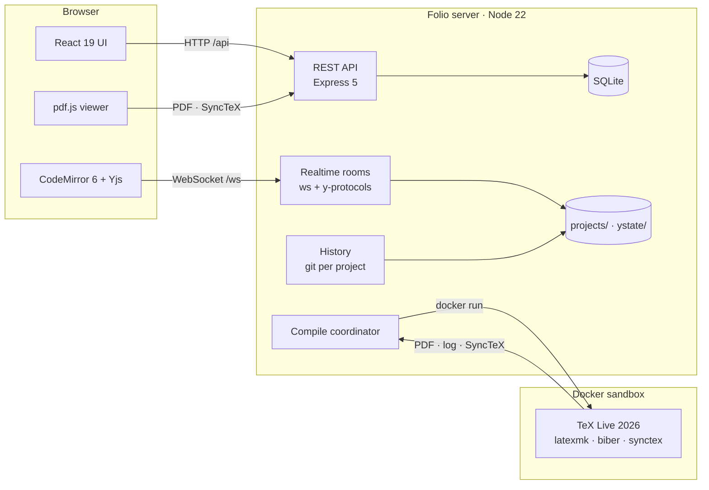

- **Text files are Yjs documents.** The server keeps each open document in memory, saves it to
  `projects/` within seconds and keeps its CRDT state in `ystate/`. The file on disk is always
  plain text, so git, zip export and compiles read ordinary files.
- **A compile sees your last keystroke.** It first waits until the server has every edit you made,
  copies the project into a persistent compile directory, runs latexmk in a fresh sandbox
  container, and publishes an immutable build. Identical snapshots are served from cache, and
  concurrent requests are merged.
- **History is committed on its own schedule:** after 30 s of quiet (at most every 5 minutes while
  people type), before a restore or a label, and before a file is deleted or overwritten, so a
  deleted file's latest text can always be restored.
- **Unsaved edits are never dropped silently.** If a document is closed for good while it still
  holds edits the server never confirmed (for example text typed offline into a file a
  collaborator deleted meanwhile), the browser keeps that text and offers to copy it, save it as
  `name (recovered).tex`, or compare it with the current file.

<details>
<summary><b>Project layout</b></summary>
<br>

```
overleaf/
├── shared/src/     API and realtime contracts (api.ts, protocol.ts), log / SyncTeX / LaTeX parsers
├── server/src/     auth, projects, files, collab (Yjs), compile (Docker), synctex, history (git), CLI tools
├── web/src/        React app: stores, realtime sessions, editor, PDF, file tree, history, sharing, chat
├── e2e/            Playwright end-to-end specs
├── scripts/        setup, isolated dev instances, the e2e server
└── docs/           SPEC.md (design), research notes, README images
```

</details>

The design document is [docs/SPEC.md](docs/SPEC.md). The research behind it (editor stack,
PDF/SyncTeX, log parsing, collaboration, security) is in [docs/research/](docs/research/). The REST
and realtime contracts are [shared/src/api.ts](shared/src/api.ts) and
[shared/src/protocol.ts](shared/src/protocol.ts).

<br>

<a id="roadmap"></a>

## 🧭 Not in Folio (yet)

Nothing here is promised. It is simply what today's version does not do.

| Missing | Where that leaves you |
|---|---|
| Comments and a review panel | Discuss in the project chat, or in the `.tex` as `%` comments |
| Track changes | History shows every version and who changed what |
| Transfer of ownership | The new owner copies the project; the copy is theirs |
| A templates gallery | Blank, the example project, or upload a `.zip` |
| Dashboard tags | Search, and the filters (yours, shared, archived, trashed) |
| Per-line author attribution in history | A version names its authors, and its diff shows the change |
| GitHub, Dropbox or reference-manager sync | Download a `.zip`, or read the project's git repository |
| Email (invitations, password reset) | Share links, `npm run create-user`, `npm run reset-password` |

<br>

<a id="licence"></a>

## 📄 Licence

Folio is free software under the **GNU Affero General Public License v3.0** ([LICENSE](LICENSE)).
You may run, study, change and share it. If you offer a modified Folio to other people over a
network, you must offer them its source too.

Folio contains no Overleaf source code; third-party components and their licences are listed in
[NOTICE.md](NOTICE.md).

<br>

<div align="center">

### Ready?

```bash
npm install && npm run build && npm start
```

The design document is [docs/SPEC.md](docs/SPEC.md) · [AGPL-3.0](LICENSE) · Third-party notices in [NOTICE.md](NOTICE.md)

<sub>Built with Node.js, React, CodeMirror, Yjs, pdf.js and TeX Live</sub>

</div>
